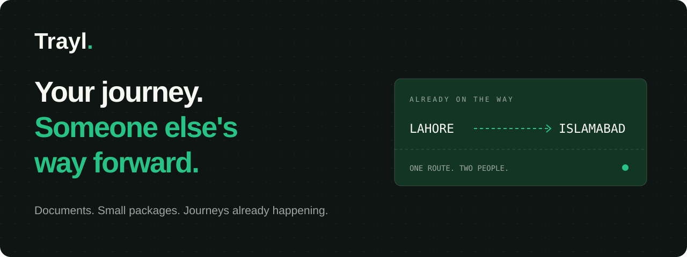
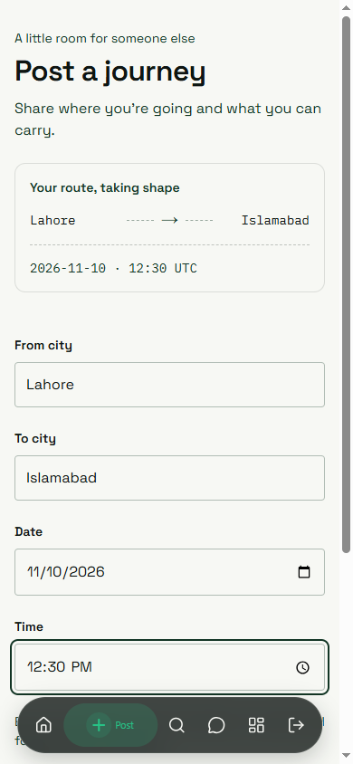
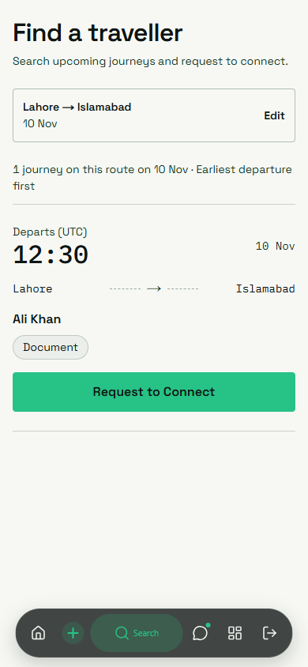
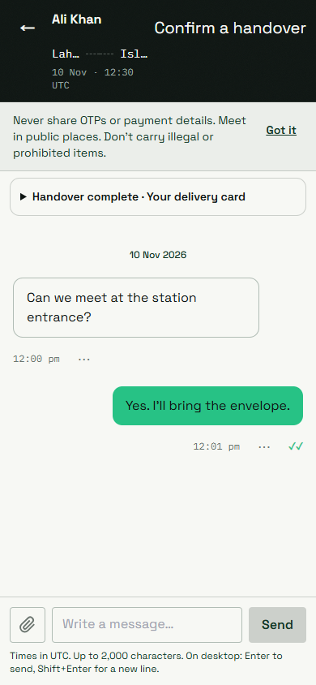
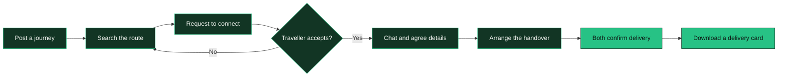
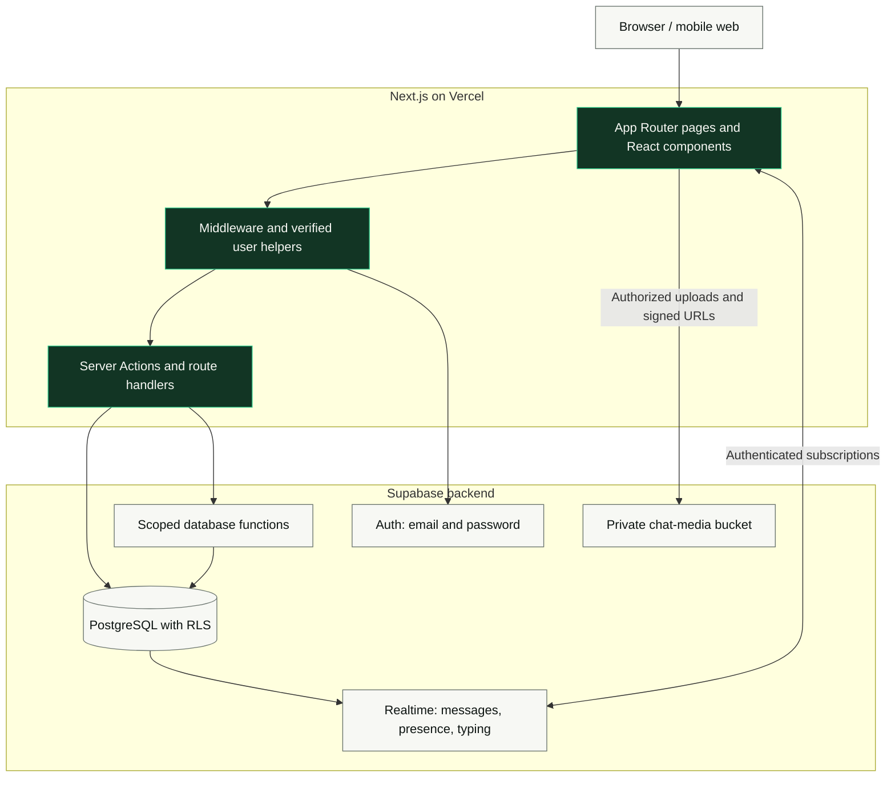

<p align="center">
  
</p>

<p align="center">
  <strong>A little room in your journey. A big help to someone else.</strong><br />
  Connect with travellers carrying documents and small packages along the same route.
</p>

<p align="center">
  <a href="https://trayl-ten.vercel.app"><strong>Try Trayl ↗</strong></a> ·
  <a href="#a-look-inside">Screenshots</a> ·
  <a href="#how-it-fits-together">Architecture</a> ·
  <a href="#run-it-locally">Quick start</a> ·
  <a href="DEPLOYMENT.md">Deployment</a>
</p>

<p align="center">
  
  
  
  
  
</p>

## The idea

A document needs to get from Lahore to Islamabad. Someone is already making that trip.
Trayl helps those two people find each other, agree on the details, and arrange a handover.

Travellers post their route. Senders search by city and date. Once a request is accepted,
they can chat and share contact details. Both people confirm when the individual delivery is complete.

## A look inside

<table>
  <tr>
    <th>Post your route</th>
    <th>Find a traveller</th>
    <th>Agree the details</th>
  </tr>
  <tr>
    <td></td>
    <td></td>
    <td></td>
  </tr>
</table>

<sub>Illustrative captures of Trayl's UI with staged route details and fictional conversation data. No private user conversations or credentials are included.</sub>

## From a route to a handover



| What you can do | How Trayl handles it |
| --- | --- |
| **Post or discover a journey** | Searchable city selection, date/time filters, live ticket preview, and paginated results. |
| **Manage your requests** | Received/sent requests, accept or decline, journey cancellation, and history. |
| **Talk after acceptance** | Realtime messages, typing/presence, unread counts, and read receipts. |
| **Share the details** | Images, videos, PDFs, and contact information available through authorized access. |
| **Confirm a delivery** | Separate confirmations from both participants; a downloadable route/date card. |
| **Report a problem** | Blocking, reports, message rate limits, and admin moderation tools. |

## How it fits together



Server operations verify the user; database policies enforce which rows they can access.
Contact details are revealed through `contact_reveal`, and chat media stays in a private
bucket accessed through expiring signed URLs. Client-side validation is not the security boundary.

## Run it locally

**Prerequisites:** Node.js 22+, npm, and a Supabase project.

```sh
npm ci
```

Copy the example environment file:

```powershell
# Windows PowerShell
Copy-Item .env.local.example .env.local
```

```sh
# macOS / Linux
cp .env.local.example .env.local
```

Add your own Supabase values to `.env.local`:

```dotenv
NEXT_PUBLIC_SUPABASE_URL=https://YOUR_PROJECT_REF.supabase.co
NEXT_PUBLIC_SUPABASE_ANON_KEY=YOUR_PUBLIC_ANON_KEY
```

Apply the migrations to your intended Supabase project:

```sh
supabase login
supabase link --project-ref YOUR_PROJECT_REF
supabase db push --dry-run
supabase db push
```

Enable email/password authentication in Supabase and configure the local Site URL and
email-confirmation settings as described in the [development guide](docs/DEVELOPMENT.md#authentication-setup).
Then start Trayl:

```sh
npm run dev
```

Open **[localhost:3000](http://localhost:3000)**. For a Docker-backed local Supabase instance,
follow [the optional local setup](docs/DEVELOPMENT.md#optional-local-supabase).

> Keep `.env.local`, account tokens, private captures, and database exports out of Git.
> The browser uses the public anon key; never put a service-role or secret key in a
> `NEXT_PUBLIC_` variable. See [deployment instructions](DEPLOYMENT.md) for Vercel environment settings.

## Explore the code

```text
app/                     Pages, Server Actions, and route handlers
components/              Forms, navigation, journeys, inbox, and chat UI
  ui/                    Shared design-system primitives and CityCombobox
lib/                     Auth, Supabase clients, validation, and data helpers
  data/cities.json        Canonical city options for journey inputs
supabase/
  migrations/            Versioned schema, RLS, functions, and indexes
  tests/                 Database access and policy checks
tests/                   Application regression tests and isolated UI fixtures
docs/                    Development guide and public README images
```

## Check your changes

```sh
npm run lint
npm run typecheck
npm test
npm run build
```

| Guide | What it covers |
| --- | --- |
| [Development guide](docs/DEVELOPMENT.md) | Authentication, environment variables, implementation notes, and migration map. |
| [Deployment](DEPLOYMENT.md) | Supabase setup and Vercel deployment. |
| [Chat test plan](CHAT_TEST_PLAN.md) | Participant access, media permissions, realtime, and error states. |
| [Delivery test plan](DELIVERY_MOMENTS_TEST_PLAN.md) | Two-party confirmation and shareable delivery cards. |
| [Design review](DESIGN_REVIEW.md) | Accessibility, responsive layouts, motion, and contrast. |
| [Isolated UI preview](tests/ui-preview/README.md) | Review screens using synthetic data without real accounts. |

## Current boundaries

Trayl coordinates peer-to-peer handovers; it does not provide payments, insurance,
identity verification, ratings, or a delivery guarantee. Journey dates and times use UTC.

This project remains on Next.js 14. The original setup recorded dependency advisories;
that historical count is not a current audit result. Review dependencies with `npm audit`
and plan a supported, patched framework upgrade before treating it as production-ready.

---

<p align="center"><strong>Already on the way.</strong><br />Built for the little things that need to get somewhere.</p>
